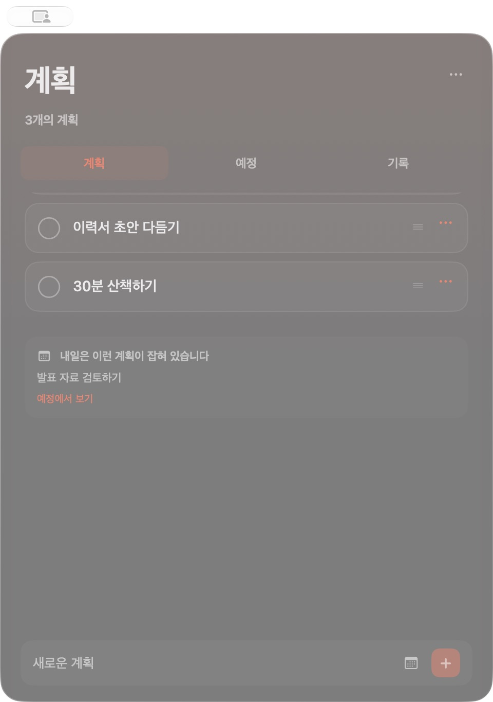
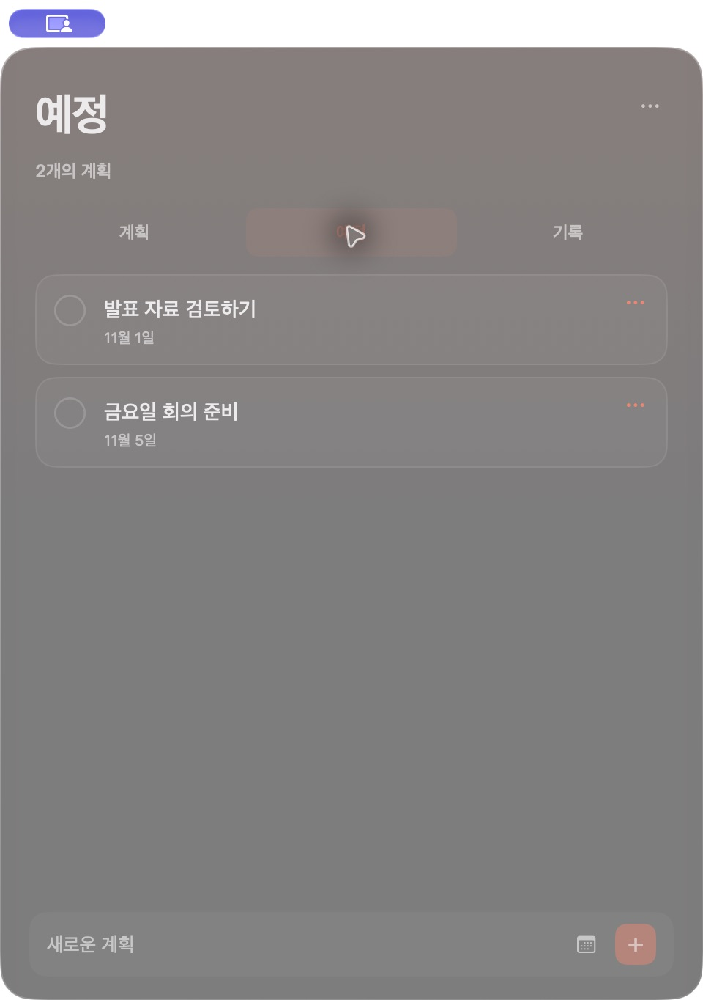

<div align="center">
  
  <h1>Took Mac</h1>
  <p><strong>끝낼 때까지, 내 계획은 여기에.</strong></p>
  <p>맥 바탕화면에서 보고, 필요할 때 열고, 끝나면 체크하세요.</p>
  <p>
    
    
    
  </p>
  <p><a href="#시작하기">시작하기</a> · <a href="#실제-앱-화면">앱 화면</a> · <a href="docs/DEVELOPMENT.md">개발 가이드</a></p>
</div>


<p align="center"><sub>대표 이미지는 직접 제작한 AI 브랜드 비주얼입니다. 아래 화면은 실제 앱을 촬영했습니다.</sub></p>

## 가볍게 적고, 하나씩 끝내기

날짜가 지났다고 계획이 사라지지 않습니다. 끝낸 계획을 체크할 때까지 목록에 남겨 두세요.

| 계획 | 예정 | 기록 |
| :--- | :--- | :--- |
| 완료할 때까지 남는 목록 | 미래 날짜의 계획을 미리 보기 | 완료한 계획과 휴지통 |
| 드래그로 나만의 순서 정하기 | 내일 계획은 목록 아래 작은 예고로 | 복원하거나 완료·삭제 기록 함께 비우기 |

- **바탕화면 위젯** — 작은·중간·큰 크기로 계획을 보고 바로 완료합니다.
- **조용한 백그라운드** — 메뉴 막대에서 대기하고, 필요할 때 기존 창 하나를 엽니다.
- **선명한 글래스 스타일** — 흐림 없이 배경색을 유지하며 시스템·밝게·어둡게 모양을 선택합니다.
- **반복 계획** — 매일, 평일, 매주 반복할 계획을 정합니다.
- **맥 안에 저장** — 앱과 위젯이 같은 로컬 파일을 공유합니다.

## 실제 앱 화면

앱 화면과 동작은 그대로 촬영하고, 계획 내용은 소개용 예시로 바꿨습니다. 개인 내역은 포함하지 않았습니다.

<table>
  <tr>
    <th align="center">계획과 내일 예고</th>
    <th align="center">미래 날짜의 예정</th>
  </tr>
  <tr>
    <td align="center"></td>
    <td align="center"></td>
  </tr>
</table>

## 시작하기

Xcode와 Swift 6가 설치된 맥에서:

```sh
git clone https://github.com/Hlxecz/Took_mac.git
cd Took_mac
Scripts/install-app.sh
```

설치 스크립트가 앱과 위젯을 함께 빌드하고, `~/Applications/Took Mac.app`에 설치한 뒤 위젯 등록을 갱신합니다. 개인용 로컬 빌드는 개발자 계정 없이 사용할 수 있습니다.

1. **계획 열기** — 메뉴 막대의 체크 아이콘이나 위젯의 `+`를 누릅니다.
2. **계획 추가** — 내용을 적고 Enter. 달력 버튼으로 미래 날짜나 반복을 정합니다.
3. **위젯 추가** — 바탕화면 우클릭 → **위젯 편집 → Took Mac**에서 크기를 골라 배치합니다.
4. **다시 백그라운드로** — 창 밖을 클릭하거나 창을 닫으면 숨겨집니다.

> GitHub에 푸시하면 자동 빌드되어 ZIP 파일이 Actions에 보관됩니다. 맥에 설치하거나 바탕화면에 위젯을 배치하는 작업까지 자동으로 실행되지는 않습니다.

## 톡톡, 열고 다시 숨기기

맥북 몸체를 두 번 두드려 계획 창을 열고, 다시 두 번 두드려 숨길 수 있습니다.

**설정 → 몸체를 두 번 두드려 계획 열고 숨기기**에서 켭니다. 기본값은 꺼짐이며, 두드리는 세기를 조절할 수 있습니다.

<details>
<summary>두드리기 감지에 관해</summary>

- 맥북 내장 가속도 센서로 몸체의 진동을 읽습니다. 마이크와 카메라는 사용하지 않습니다.
- 입력 내용은 읽지 않습니다. 마지막 키·클릭 이후 경과 시간으로 입력 직후의 진동을 억제합니다.
- 오른쪽 아래만 독점적으로 구분하지는 않습니다. 다른 위치나 책상 진동도 인식할 수 있습니다.
- 비공개 센서 인터페이스를 사용하므로 모델·OS별로 동작이 달라질 수 있습니다. 연결 상태는 설정에서 확인합니다.
- 절전 중에는 멈추고, 깨우면 재연결합니다.

</details>

## 저장과 복원

계획은 `~/Library/Application Support/TookMac/tasks.json`에 저장됩니다. 완료·삭제 기록에서 복원하고 마지막 변경을 되돌릴 수 있습니다.

**기록 비우기는 영구 삭제**입니다. 완료 기록과 휴지통을 함께 비우며 복원할 수 없습니다. 진행 중인 계획과 예정된 계획은 그대로 유지됩니다.

원본 iOS Took의 단순한 사용 흐름을 참고해 새로 구현한 독립 프로젝트입니다. 원본 앱의 코드·자산을 사용하지 않으며, 원본 Took 및 iCloud와 연결되지 않습니다.

---

[개발·빌드·위젯 진단](docs/DEVELOPMENT.md) · [변경 내역](CHANGELOG.md) · [한글 커밋 규칙](CONTRIBUTING.md) · [로고·이미지 제작 정보](docs/BRAND.md)
